# WorldBox-LOTM-Expansion

**《诡秘之主—宿命之环》拓展模组 · v1.0.0 正式版**

*在灰雾笼罩的历史深处，仍有尚未揭晓的秘密。*

## 📥 下载与安装包

**[⬇ 下载 v1.0.0 正式版安装包](https://github.com/CryssyVyn/WorldBox-LOTM-Expansion/releases/download/v1.0.0/WorldBox-LOTM-Expansion-1.0.0.zip)**

[查看全部版本](https://github.com/CryssyVyn/WorldBox-LOTM-Expansion/releases)　｜　[下载 v1.0.0 源码包](https://github.com/CryssyVyn/WorldBox-LOTM-Expansion/releases/download/v1.0.0/WorldBox-LOTM-Expansion-source-1.0.0.zip)　｜　[原模组资源](https://github.com/Worldbox-OWL/mod-resources)

> **必需前置：** WorldBox 0.51.x、NML 1.2.0.1，以及伊度氢制作的《诡秘之主—宿命之环》4.1。本项目是**独立附属扩展**，需要与原模组同时安装，不覆盖原模组源码或磁盘上的 DLL。

本项目是为 WorldBox《诡秘之主—宿命之环》4.1 制作的独立附属扩展。

原模组已经构建了二十二条非凡途径、魔药晋升、非凡家族、教会组织、神灵与旧日等丰富的玩法。在此基础上，我们希望进一步完善非凡知识的获取与传承，让那些来自原著的特殊物品和人物身份，能够真正参与游戏世界的发展。

因此，本拓展加入了二十二张亵渎之牌、前纪遗民与故乡馈赠、灵性纪元、可独立开关的王国命名系统等内容，并对组织知识传承、神国谋划、王权限制及部分游戏异常进行了调整。

这些改动并不是为了改变原模组的整体方向，而是希望让一个不断演化的非凡世界，拥有更多值得观察和探索的可能。

> **当前版本：** v1.0.0 正式版。  
> **项目作者：** CryssyVyn  
> **原模组作者：** 伊度氢

**快速导航：** [亵渎纸牌美术展示](#亵渎纸牌美术展示) · [主要拓展内容](#主要拓展内容) · [王国命名](#2-王国命名让每一个国家都拥有自己的历史) · [安装说明](#安装说明) · [兼容性与存档](#兼容性与存档) · [图像使用声明](#纸牌图像使用声明)

---

## 亵渎纸牌美术展示

### 前纪遗民

<a href="WorldBox-LOTM-Expansion-README-images/docs/images/gallery/00-ancient-survivor.png">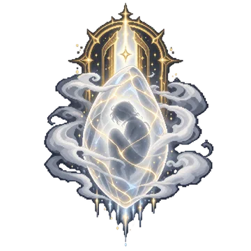</a>

### 亵渎之牌 · 罗塞尔的二十二种神之姿态
<table align="center"><tr>
<td align="center"><a href="WorldBox-LOTM-Expansion-README-images/docs/images/gallery/01-fool-roselle.png">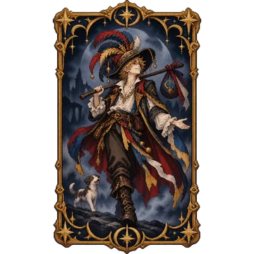</a> 愚者·罗塞尔版</td>
<td align="center"><a href="WorldBox-LOTM-Expansion-README-images/docs/images/gallery/01-fool-symbol.png">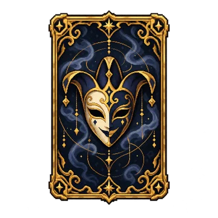</a> 愚者·游戏版</td>
<td align="center"><a href="WorldBox-LOTM-Expansion-README-images/docs/images/gallery/02-demoness-roselle.png">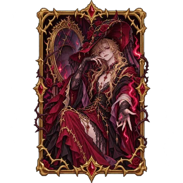</a> 魔女·罗塞尔版</td>
<td align="center"><a href="WorldBox-LOTM-Expansion-README-images/docs/images/gallery/02-demoness-symbol.png">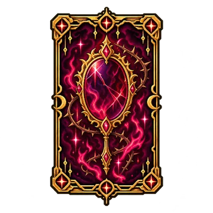</a> 魔女·游戏版</td>
</tr></table>
<table align="center"><tr>
<td align="center"><a href="WorldBox-LOTM-Expansion-README-images/docs/images/gallery/03-darkness-roselle.png">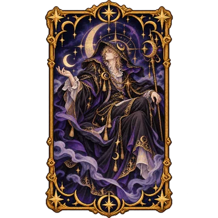</a> 黑夜·罗塞尔版</td>
<td align="center"><a href="WorldBox-LOTM-Expansion-README-images/docs/images/gallery/03-darkness-symbol.png">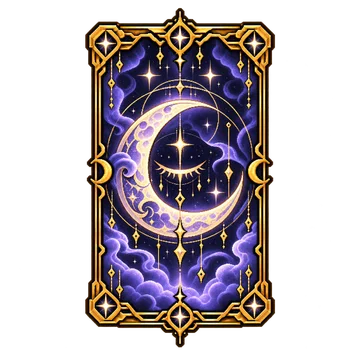</a> 黑夜·游戏版</td>
<td align="center"><a href="WorldBox-LOTM-Expansion-README-images/docs/images/gallery/04-visionary-roselle.png">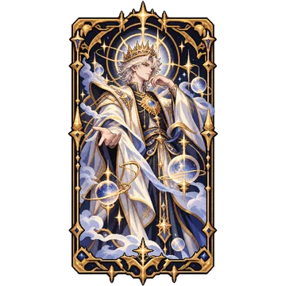</a> 空想家·罗塞尔版</td>
<td align="center"><a href="WorldBox-LOTM-Expansion-README-images/docs/images/gallery/04-visionary-symbol.png">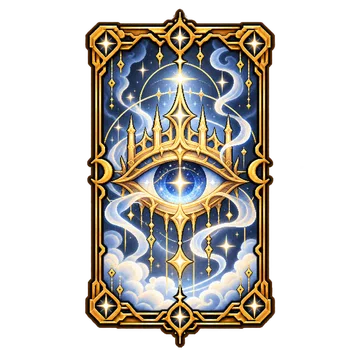</a> 空想家·游戏版</td>
</tr></table>
<table align="center"><tr>
<td align="center"><a href="WorldBox-LOTM-Expansion-README-images/docs/images/gallery/05-black-emperor-roselle.png">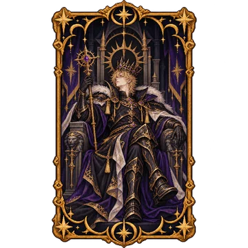</a> 黑皇帝·罗塞尔版</td>
<td align="center"><a href="WorldBox-LOTM-Expansion-README-images/docs/images/gallery/05-black-emperor-symbol.png">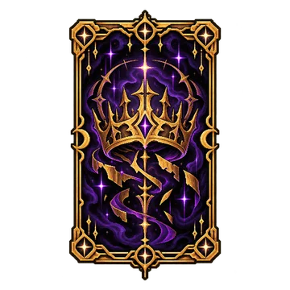</a> 黑皇帝·游戏版</td>
<td align="center"><a href="WorldBox-LOTM-Expansion-README-images/docs/images/gallery/06-death-roselle.png">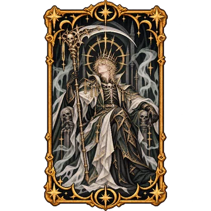</a> 死神·罗塞尔版</td>
<td align="center"><a href="WorldBox-LOTM-Expansion-README-images/docs/images/gallery/06-death-symbol.png">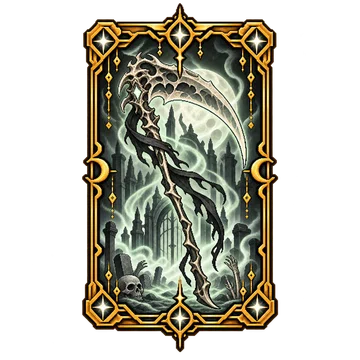</a> 死神·游戏版</td>
</tr></table>
<table align="center"><tr>
<td align="center"><a href="WorldBox-LOTM-Expansion-README-images/docs/images/gallery/07-mother-roselle.png">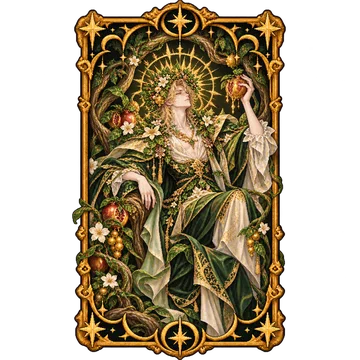</a> 母亲·罗塞尔版</td>
<td align="center"><a href="WorldBox-LOTM-Expansion-README-images/docs/images/gallery/07-mother-symbol.png">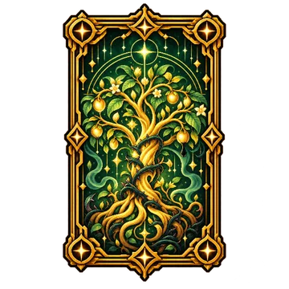</a> 母亲·游戏版</td>
<td align="center"><a href="WorldBox-LOTM-Expansion-README-images/docs/images/gallery/08-moon-roselle.png">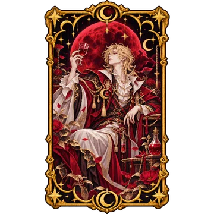</a> 月亮·罗塞尔版</td>
<td align="center"><a href="WorldBox-LOTM-Expansion-README-images/docs/images/gallery/08-moon-symbol.png">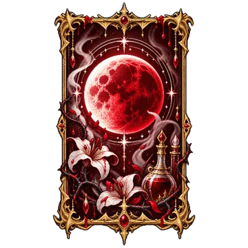</a> 月亮·游戏版</td>
</tr></table>
#### 其余十四条途径 · 人物版
<table align="center"><tr>
<td align="center"><a href="WorldBox-LOTM-Expansion-README-images/docs/images/gallery/09-white-tower-roselle.png">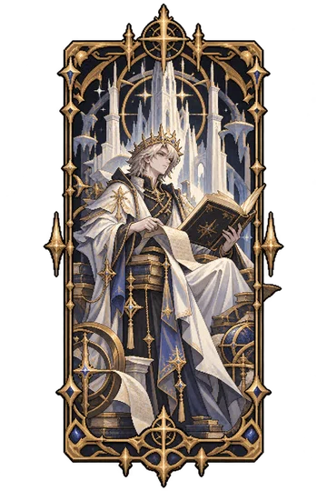</a> 白塔·罗塞尔版</td>
<td align="center"><a href="WorldBox-LOTM-Expansion-README-images/docs/images/gallery/10-tyrant-roselle.png">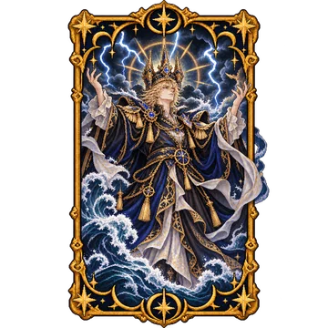</a> 暴君·罗塞尔版</td>
<td align="center"><a href="WorldBox-LOTM-Expansion-README-images/docs/images/gallery/11-chained-roselle.png">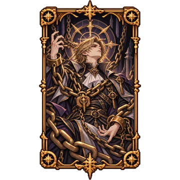</a> 被缚者·罗塞尔版</td>
<td align="center"><a href="WorldBox-LOTM-Expansion-README-images/docs/images/gallery/12-error-roselle.png">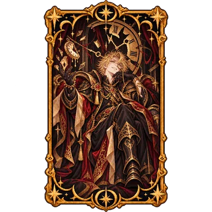</a> 错误·罗塞尔版</td>
</tr></table>
<table align="center"><tr>
<td align="center"><a href="WorldBox-LOTM-Expansion-README-images/docs/images/gallery/13-hanged-man-roselle.png">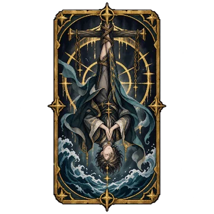</a> 倒吊人·罗塞尔版</td>
<td align="center"><a href="WorldBox-LOTM-Expansion-README-images/docs/images/gallery/14-red-priest-roselle.png">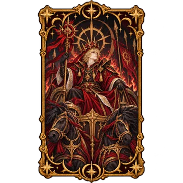</a> 红祭司·罗塞尔版</td>
<td align="center"><a href="WorldBox-LOTM-Expansion-README-images/docs/images/gallery/15-twilight-giant-roselle.png">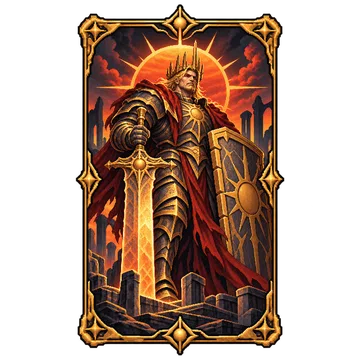</a> 黄昏巨人·罗塞尔版</td>
<td align="center"><a href="WorldBox-LOTM-Expansion-README-images/docs/images/gallery/16-door-roselle.png">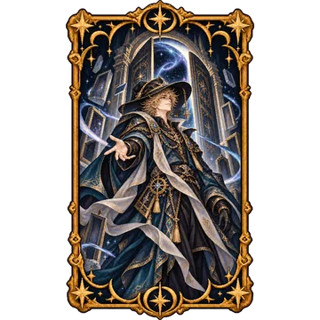</a> 门·罗塞尔版</td>
</tr></table>
<table align="center"><tr>
<td align="center"><a href="WorldBox-LOTM-Expansion-README-images/docs/images/gallery/17-wheel-of-fortune-roselle.png">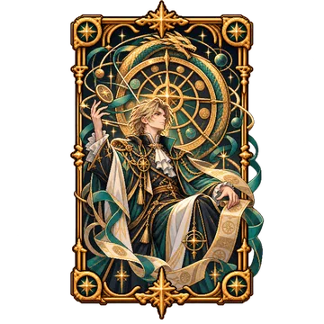</a> 命运之轮·罗塞尔版</td>
<td align="center"><a href="WorldBox-LOTM-Expansion-README-images/docs/images/gallery/18-abyss-roselle.png">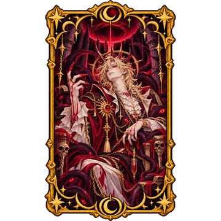</a> 深渊·罗塞尔版</td>
<td align="center"><a href="WorldBox-LOTM-Expansion-README-images/docs/images/gallery/19-justiciar-roselle.png">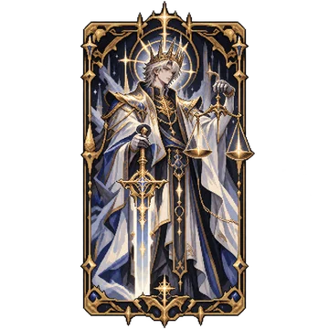</a> 审判者·罗塞尔版</td>
<td align="center"><a href="WorldBox-LOTM-Expansion-README-images/docs/images/gallery/20-sun-roselle.png">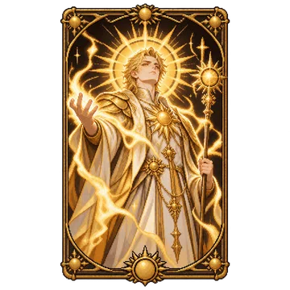</a> 太阳·罗塞尔版</td>
</tr></table>
<table align="center"><tr>
<td align="center"><a href="WorldBox-LOTM-Expansion-README-images/docs/images/gallery/21-paragon-roselle.png">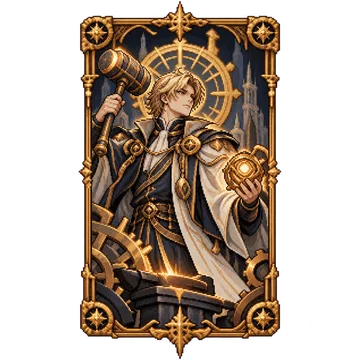</a> 完美者·罗塞尔版</td>
<td align="center"><a href="WorldBox-LOTM-Expansion-README-images/docs/images/gallery/22-hermit-roselle.png">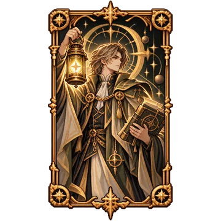</a> 隐者·罗塞尔版</td>
</tr></table>

---

## 主要拓展内容

### 1. 亵渎之牌——二十二条神之途径的秘密

在非凡世界中，知识本身就是一种力量。

一份完整的魔药配方，或许就能决定一名非凡者能否继续向上攀登。教会、家族与隐秘组织掌握着各自的知识，而那些不为人知的配方，往往比非凡材料本身更加难以获得。

在原模组中，魔药配方同样影响着非凡者的晋升成功率。当玩家试图培养一名心仪的高序列角色时，即使角色已经积累了相当的力量，缺少对应的配方，也可能使晋升成功率仍然偏低。

于是，我们想到了罗塞尔留下的那二十二张纸牌。

在《诡秘之主》原著中，罗塞尔·古斯塔夫将二十二条神之途径的秘密藏入亵渎之牌。每张纸牌对应一条途径，记载着从低序列直至神灵领域的魔药配方与晋升仪式。这些散落在世界各处的纸牌，既是珍贵的神秘物品，也是足以引起非凡者争夺的知识宝藏。

**本拓展将这二十二张亵渎之牌带入了 WorldBox。**

每张纸牌都是独一无二的存在。无论是「愚者」「黑皇帝」，还是其他途径对应的纸牌，同一个世界中都只能存在一张。

更重要的是，**亵渎之牌并不占用原模组的非凡特性池。** 纸牌不会消耗对应途径原有的非凡特性，也不会挤占其他非凡者获取特性的机会。

它们所承载的是知识，而非凭空增加的非凡特性。

然而，得到纸牌与读懂纸牌，并不是同一回事。

在本拓展中，只有具备「前纪遗民」身份的角色，才能解读亵渎之牌中隐藏的配方。对于那些无法解读它的人而言，纸牌所承载的秘密依然不可触及。

即使成功掌握了配方，也不意味着能够安然晋升。魔药材料、晋升仪式及其他必要条件仍然需要满足，非凡之路上的危险不会因此消失。

而秘密之所以珍贵，正是因为它不属于所有人。

从纸牌中获得的配方首先属于持有者本人，不会自动成为家族或教会的公共知识。持有者可以自行利用这些知识，也可以在符合条件时将其传授给他人。

每张纸牌初始拥有八点耐久。自行使用知识不会消耗耐久，但向外传授知识会受到耐久与授业间隔等规则的限制。

一张纸牌可以改变某个人的晋升道路，却不会让整个世界在一夜之间知晓其中的秘密。

**关于纸牌的外观，我们也进行了一次取舍。**

原著中的亵渎之牌，正面描绘着罗塞尔以不同途径对应形象装扮的模样。最初制作图标时，我们尝试还原这一设计，并创作了**罗塞尔人物版**的牌面画作。

然而，受 WorldBox 游戏图标尺寸的限制，复杂的人物与服饰细节在缩小后难以辨认，不同纸牌之间也缺少足够鲜明的区别。

因此，**游戏内采用对应途径的象征符号与标识作为牌面主体**，保留统一的神秘纸牌风格；而以罗塞尔为主体的原画则作为另一套创作版本保留，用于欣赏与展示。

这并不是取消罗塞尔的人物版设计，而是让**原画展示**与**游戏内识别度**各得其所。

### 2. 王国命名——让每一个国家都拥有自己的历史

国家不仅是一片疆土，也是一段被信仰、王权与岁月共同书写的历史。

在《诡秘之主》与《宿命之环》的世界中，「所罗门」「图铎」「拜朗」等名称承载着各自的时代，而一个国家所信奉的教会、它走过的兴衰，也足以形成独特的文化气质。

WorldBox 可以让我们观察文明兴衰，但随机生成的国家名称未必能体现非凡世界的这些特色。为了让不同教派的国度拥有更加鲜明的辨识度，本拓展加入了**独立的王国自动命名系统**。

#### 二十二教派与专属国名

系统围绕原模组的 **22 个教派／组织**分别准备精选名称，并结合原著、其他幻想作品与神话传说建立候选池。不同教派拥有各自的命名倾向，例如：

| 教派／组织 | 部分名称示例 |
| --- | --- |
| 黑夜教会 | 影之国、诺克史黛拉、永夜庭、静谧王庭 |
| 血族 | 亚楠、红魔馆、月之都、银月城 |
| 风暴教会 | 阿戈尔、伊比利亚、亚特兰蒂斯、归墟 |
| 知识与智慧教会 | 须弥、莱塔尼亚、白塔城、真理国 |
| 蒸汽与机械教会 | 哥伦比亚、枫丹、机巧城、铜辉城 |
| 命运隐士会 | 冬木、迦勒底、逆时之都、轮转城 |
| 魔女教派 | 魔法森林、迷途竹林、雾之湖、地灵殿 |

这些名称是**候选示例**，并非绑定某个国家的唯一名称。全部二十二组教派拥有各自的候选方案；没有专属可用候选时，仍可使用通用国名。

#### 王国命名 · 实机效果展示

*不同信仰与文明交织，在漫长的历史中诞生各具特色的国度。*

<a href="WorldBox-LOTM-Expansion-README-images/docs/images/gallery/kingdom-names.png">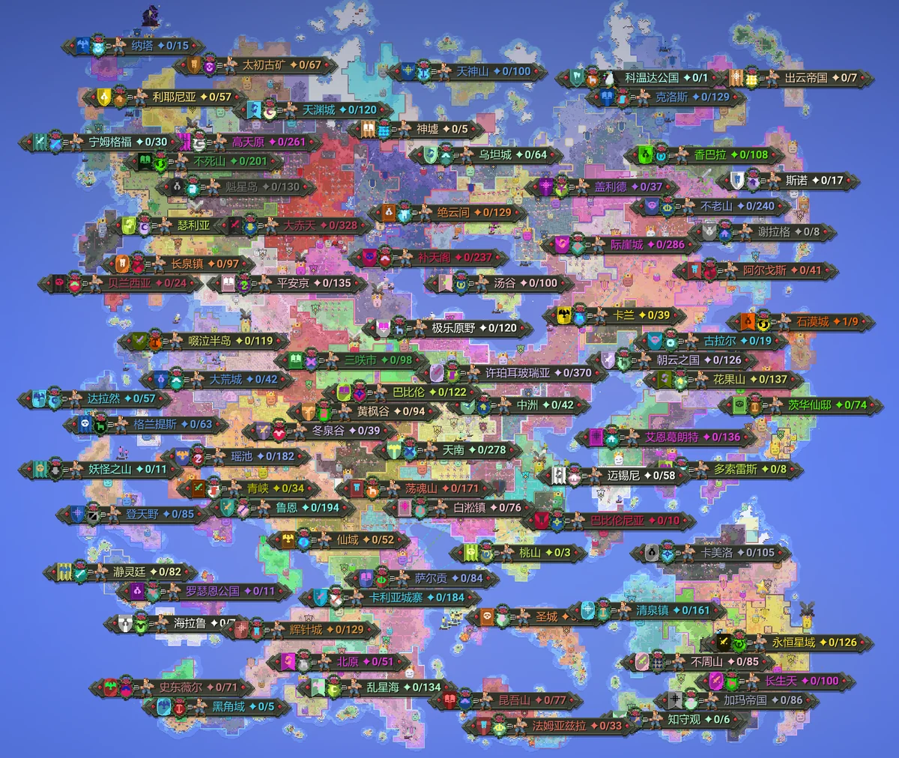</a>

*点击图片可查看高清原图。*

#### 历史、继承与新的国家

一个王国即使已经灭亡，其名称也不应永远消失。

因此，自动命名优先考虑历史名称的恢复；原名已被其他国家占用时，可以使用符合规则的衍生名称。随后再按教派精选、通用名称与随机生成候选的规则继续尝试。

这意味着，曾经消逝的名字有机会随着新王国的建立再次出现在地图上。无论是熟悉的幻想国度，还是在漫长演化中诞生的新名称，都可以成为世界历史的一部分。

系统还会保留对名称冲突的检查，避免简单地把同一个名字反复分配给不同国家。当精选名称与生成候选均不可用时，则保留已有的命名结果。

#### 是否启用，由玩家决定

**国名功能配有独立开关。** 玩家可以按自己的游戏习惯，决定是否启用本拓展的王国自动命名。

- **开启：** 允许本拓展在符合条件的命名时机，为王国分配具有教派特色的名称。
- **关闭：** 停止本拓展后续的自动国名分配，让其他原有命名逻辑继续工作。关闭开关不等于自动撤销所有已经使用的名称。
- **手动改名：** 尊重玩家主动指定并锁定的名称，不让自动命名覆盖这一选择。

这套系统不要求玩家改变原有的建国方式；你可以开启它，让非凡世界自然诞生更多熟悉的国度，也可以关闭它，继续使用自己偏好的命名模组与规则。

### 3. 前纪遗民与故乡馈赠——来自旧时代的回响

对某些人而言，最遥远的距离并非横亘在眼前的山海，而是永远无法回去的过去。

他们曾经生活在一个熟悉的时代，有自己的家人、朋友与日常生活。然而，当漫长的沉眠结束，熟悉的一切早已消失在历史深处。旧日的文明不复存在，曾经习以为常的事物成为无人知晓的秘密，就连那些关于故乡的记忆，也再难找到能够与之分享的人。

他们并非来到了另一个世界，只是醒来时，那个属于他们的时代已经结束了。

在《诡秘之主》原著中，黑夜女神阿曼妮西斯、罗塞尔·古斯塔夫与克莱恩·莫雷蒂，便是先后从源堡苏醒的旧文明遗民。

远古太阳神同样来自第一纪之前的旧文明，只是与前三人不同，祂从混沌海中苏醒，以另一种方式参与了后来世界的历史。

本拓展以这一原著设定为基础，加入了特殊身份——**「前纪遗民」**。

#### 来自同一个时代的人

来自同一个失落时代的人，即使素不相识，或许也会因为某些共同的记忆而感到亲近。

在本拓展中，拥有「前纪遗民」身份的角色更容易与其他同类建立友好关系。

与此同时，他们受到的部分污染影响有所减轻，对于符合特定来源条件的理智冲击，也拥有一定的抵抗能力。

这些特殊之处并不意味着前纪遗民能够免疫疯狂与污染。即使来自旧文明，也无法完全摆脱非凡力量带来的危险。

此外，前纪遗民还拥有解读亵渎之牌的特殊资格。对于其他角色无法理解的纸牌知识，他们有机会从中获得对应途径的晋升配方。

#### 故乡馈赠

一个人能够掌握的知识终究有限，而非凡世界中的隐秘，也并非全部来自亵渎之牌。

随着自身的成长，非凡者可以通过阅读、研究或亲身经历晋升，逐渐掌握更多魔药配方。然而，即使某个人已经知晓某条途径的晋升方法，也不意味着他的家族、教会或身边的其他人同样知晓。

既然来自旧时代的人能够通过亵渎之牌或自身经历掌握这些秘密，那么，他们是否也能将自己知晓的知识传递给其他人？

基于这样的想法，本拓展为前纪遗民增加了特殊谋划——**「故乡馈赠」**。

拥有相应知识与资格的前纪遗民，可以通过这一谋划帮助其他非凡者研究、补全所需的魔药配方。

对于那些因为缺少关键配方而难以继续晋升的角色，这或许就是新的机会。

但这样的馈赠并非没有限制。

帮助他人掌握配方需要时间，也需要相应的知识依据。通过纸牌阅读获得的秘密、角色亲身经历过的晋升，以及已经掌握的其他知识，都有各自的来源与使用条件。

不同序列的配方需要经历不同的研究过程，涉及高序列乃至神灵领域的知识时，还必须满足更加严格的资格要求。

**故乡馈赠不会让角色凭空知晓所有配方，也不会绕过原有的晋升规则。**

在游戏中，符合条件的角色还可以根据自身的需求寻求帮助。AI 会考虑角色之间的距离、研究需求、已有事务及再次请求所需的间隔，不必完全依赖玩家逐一安排。

这样一来，故乡馈赠既可以帮助玩家培养自己关注的角色，也能够参与其他非凡者的成长过程。

那些从旧时代苏醒的人，或许再也无法回到记忆中的故乡。

但他们仍可以在这个陌生的时代留下属于自己的痕迹。

**故乡已经远去，而那些来自旧时代的记忆与知识，仍有机会以另一种方式延续下去。**

#### 故乡馈赠 · 图标展示

<table align="center">
<tr>
<td align="center"> 谋划按钮图标</td>
<td align="center"> 谋划执行图</td>
</tr>
</table>

### 4. 灵性纪元——神秘复苏的时代

世界的历史由一个又一个纪元组成。

在漫长的岁月中，文明兴起又衰落，王国在战争中更迭，生命随着环境的变化不断繁衍。

而在《诡秘之主》的世界里，除了世俗文明的兴衰，还有另一种力量始终影响着历史的走向——**非凡。**

灵性是非凡力量的重要基础。无论是施展非凡能力，还是维持自身的特殊状态，非凡者都离不开灵性的支持。

既然 WorldBox 已经拥有自己的纪元更替系统，那么，一个存在着神灵、魔药与非凡者的世界，也应该拥有属于非凡力量的特殊时代。

因此，本拓展新增了独立的世界纪元——**「灵性纪元」**。

#### 当灵性逐渐活跃

当世界进入灵性纪元，原本平稳流动的灵性仿佛变得更加活跃。

对于普通的王国与文明而言，世界依然按照既有规律运转。然而，那些已经踏入非凡领域的生命，却能够感受到时代带来的变化。

在灵性纪元期间：

- **自然灵性恢复速度提升至原来的 1.25 倍。**
- **被动灵性增长速度提升至原来的 1.15 倍。**

更充沛的灵性使非凡者能够更快地恢复消耗的力量，也为他们自身的成长提供了一定帮助。

但这并不意味着角色可以直接跨越序列界限，也不会取消魔药配方、晋升仪式或失控的危险。

与其他时代相比，这段岁月只是为非凡力量的发展提供了更加有利的环境。

#### 与原生纪元共同存在

灵性纪元并非独立于 WorldBox 之外的新系统。

它以原版希望纪元作为设计基础，并参考奇迹纪元的视觉表现，尽量营造明亮而富有神秘感的氛围。

**灵性纪元不会替换希望纪元，也不会覆盖其他已有纪元。**

它作为一个独立纪元加入游戏，可以参与原生纪元轮换，也能够由玩家手动选择。

当这一时代结束，灵性恢复与增长的额外加成随之消失，世界重新进入下一个纪元。此前已经获得的成长则会保留下来。

在漫长的历史中，没有任何一个时代能够永远延续。

也许在某个纪元，战争与灾难席卷大地；而在另一个纪元，灵性悄然活跃，那些原本默默无闻的非凡者，也迎来了属于自己的机遇。

### 5. 非凡知识与组织传承——秘方并非人人可得

在非凡世界中，一份魔药配方的价值，往往不亚于它所对应的非凡特性。

有些配方被掌握在教会手中，有些由古老的非凡家族代代相传，还有一些随着知情者的死亡，逐渐消失在历史的迷雾之中。

对于一名缺乏背景的非凡者而言，即使已经收集到晋升所需的材料，也未必能够知晓正确的魔药配方。而那些受到家族培养、拥有教会支持的人，则可能沿着前人留下的道路，一步步向更高的序列迈进。

**知识的掌握与传承，本就是非凡世界中权力的重要来源。**

原模组已经建立了家族、教会、魔药与晋升等相关系统。本拓展在此基础上，进一步完善了配方的获取、归档与传承规则。

#### 个人的秘密与组织的财富

设想一位拥有「前纪遗民」身份的非凡者，得到了一张亵渎之牌，并从中解读出某条途径的高序列配方。

对他而言，这或许是一份足以改变自身晋升道路的珍贵知识。

但如果他恰好出身于某个非凡家族，或者是一位教会成员，是否就意味着整个家族、整座教会也随之掌握了这份秘密？

显然并非如此。

在本拓展中，**个人掌握的配方与组织拥有的配方被明确区分。**

一名非凡者能够使用某份配方，不代表他的家族已经将它收录进传承，也不代表教会中的其他成员可以直接使用。

尤其是通过亵渎之牌获得的私人知识，不会仅仅因为持有者属于某个组织，就自动进入组织的公共配方体系。

#### 家族——延续于血脉之间的传承

古老的非凡家族往往拥有自己的主要途径，以及经过漫长岁月积累的配方知识。

本拓展进一步调整了家族中主要传承途径、其他途径及配方来源之间的关系，并完善了相应的接收与使用限制。

家族不会因为某位成员偶然获得了一份陌生途径的配方，就立即拥有一套可以无限供给后代的完整传承。

一份知识能否真正成为家族的积累，仍需要符合相应的规则。

对于玩家而言，培养一个非凡家族不再只是关注成员中出现了多少高序列强者，也可以关注他们究竟掌握了哪些知识，又能够将多少秘密留给后来者。

#### 教会——被严格守护的晋升道路

如果说家族的传承更多依赖血脉与历史，那么教会的非凡体系，则建立在更为严密的组织与知识管理之上。

本拓展进一步完善了教会配方的连续性与使用条件。

**掌握某个高序列的配方，并不等于已经掌握了通往这一序列的完整道路。**

例如，一座教会即使获得了某个高序列的珍贵配方，如果此前必要的序列知识仍然缺失，也不能立即将其视为一套已经建立完成的晋升传承。

只有相应的知识链条得到补全，相关配方才能按照组织规则发挥作用。

与此同时，教会成员能够获得哪些知识，也仍然受到组织内部条件与权限的约束。

#### 配方来源与晋升

角色可能通过个人掌握、组织供给、实验尝试或亵渎之牌中的私人秘传等不同方式，接触晋升所需的知识。

本拓展进一步整理了这些来源与晋升判断之间的关系，避免把个人秘传、组织档案与亲身经历不加区分地视为同一类知识。

不同来源的配方可以在符合条件时帮助角色晋升，但不会代替其他必要的晋升条件。

一位强大的非凡者，或许能够凭借机遇走到极高的序列。

但要让后来者也能沿着这条道路继续前进，仅有一位强者还远远不够。

**那些被记录、保存并传承下来的知识，才可能让一个家族延续数代，让一座教会在漫长的岁月中不断培养新的非凡者。**

### 6. 神国谋划与王权——神灵亦可君临人间

在《诡秘之主》的历史中，神灵并非始终隐居于神国之中，远离尘世的纷争。

第四纪，这个被称为「众神纪元」的时代，曾见证过神灵直接统治人间的历史。

所罗门帝国的「黑皇帝」、图铎帝国的「血皇帝」、特伦索斯特帝国的「夜皇」，以及南大陆拜朗帝国的「冥皇」，便是其中最著名的存在。

四位皇帝既是各自帝国的统治者，也是屹立于序列顶点的真神。

后来爆发的四皇之战，更使帝国的兴衰与神灵的命运交织在一起。

**在那个时代，神灵可以拥有自己的国度，也可以亲自坐在世俗的王座之上。**

考虑到这一原著设定，本拓展对原模组中的部分王权限制进行了调整，同时修复了神国谋划相关的异常。

#### 神国谋划的完善

原模组已经拥有较为丰富的神国、真神与旧日体系，本拓展保留了这些机制的基本规则。

不过，在实际游戏中，部分神国谋划曾出现运行异常。有时角色尚未完成谋划，便意外放弃了原本的计划；有时谋划已经结束，角色却依然保留着相关行为，影响后续行动。

本拓展对这些问题进行了针对性修复，调整了谋划的执行与结束流程。

同时，也处理了角色编辑器中的部分操作问题，避免玩家尝试为不符合资格的角色添加谋划时，意外取消该角色正在进行的其他计划。

这些改动主要用于完善已有系统，而不是重新设计神国玩法。

#### 神灵与世俗王权

在原模组中，当角色晋升为真神或旧日后，会受到强制退位与禁止重新任命为国王的限制。

但回顾第四纪的历史，四皇的存在已经表明，神灵执掌世俗王权并非没有先例。

对于 WorldBox 这样一个允许玩家自由创造和观察世界历史的游戏，我们希望保留这种可能。

因此，本拓展**取消了真神与旧日的强制退位及禁止任命限制**。

一位历经漫长岁月、最终登临神位的君主，不必仅仅因为自身的非凡位格而被迫离开王座。玩家也可以根据自己的想法，重新任命相关角色为国王。

无论是让真神继续统治亲手建立的王国，还是尝试重现第四纪由神灵执掌帝国的景象，都有了实现的可能。

这一调整并未改变神国、信仰及其他原有机制，也不意味着神灵必然成为世俗统治者。

第四纪的四位皇帝早已成为历史，昔日帝国的荣光也随战争消散。

但在 WorldBox 中，历史并不需要沿着既定的道路重演。

也许在另一个世界里，一位登临神位的君主，仍将坐在那张属于自己的王座之上。

### 7. 数值与界面优化——让非凡者的力量更加稳定

随着非凡者不断晋升，他们所拥有的力量也会逐渐超越凡人的想象。

原模组通过属性、途径能力、神性与权柄等机制表现不同层次之间的力量差距。然而，当玩家同时使用其他模组时，多种属性加成也可能相互叠加，产生超出预期的结果。

本拓展针对实际游戏中遇到的部分数值异常进行了处理，同时完善了人物信息与界面的显示。

#### 生命值与异常数值处理

在实际游戏中，我们曾遇到过这样一种情况：一名已经达到高序列的非凡者，在同时拥有其他模组提供的「超级生命」等特质后，生命值因多重属性加成而急剧膨胀，最终达到了远超预期的数值。

这种情况并非单纯由原模组的高序列机制引起，而是不同模组的属性效果叠加所致。

当生命值增长到极高的程度时，不仅会影响人物属性的正常表现，还可能在受到伤害、恢复生命或触发特殊能力时产生数值异常。

为此，本拓展对生命值上限、伤害边界以及溢出、无效数值等情况进行了处理，尽量避免极端数值影响角色状态及相关能力。

同时，也针对原模组 4.1 中不同途径的生命恢复、神性状态及相关能力进行了适配。

**这些修改并非为了削弱高序列角色，而是为极端属性叠加提供必要的数值保护。**

需要说明的是，本拓展并未重新设计原模组的神性创伤或真神体系。相关基础机制仍然属于原作者的实现，我们主要处理其中涉及的生命值兼容与异常问题。

#### 人物信息与界面改进

对于《诡秘之主》模组而言，角色拥有的途径、序列、配方知识及所属组织，都是值得玩家关注的信息。

本拓展对部分人物信息界面进行了补充与调整，使亵渎之牌、个人知识及组织配方等内容能够更好地融入原有界面。

与此同时，也完善了部分途径说明、图标资源与人物信息显示。

针对特质编辑器中出现的选中状态显示异常，我们进行了相应修复，改善手动编辑人物特质时的操作体验。

此外，本拓展还包含部分人物肤色资源的替换与兼容处理，尽量避免相关调整影响原有的角色生成与显示。

这些改动并不会改变 WorldBox 的基本操作方式，而是希望让玩家在观察和培养自己关注的角色时，能够获得更加清晰、稳定的体验。

---

## 安装说明

本项目是《诡秘之主—宿命之环》4.1 的**独立附属扩展**，不是原模组的替代版本。

安装前，请确认游戏环境符合以下条件：

| 项目 | 当前适配基线 |
|---|---|
| 游戏 | WorldBox 0.51.x / build 115 |
| 模组加载器 | NML 1.2.0.1 |
| 必需前置 | 《诡秘之主—宿命之环》官方 4.1 |
| 原模组 GUID | `XULIE` |
| 拓展 GUID | `WORLDBOX_LOTM_EXPANSION` |
| 拓展版本 | `v1.0.0` 正式版 |

**安装步骤**

1. 退出游戏，建议先备份需要保留的世界存档。
2. 安装原作者发布的完整《诡秘之主—宿命之环》4.1。
3. 从页面顶部下载 [**v1.0.0 正式版安装包**](https://github.com/CryssyVyn/WorldBox-LOTM-Expansion/releases/download/v1.0.0/WorldBox-LOTM-Expansion-1.0.0.zip)，解压并将 `WorldBox-LOTM-Expansion` 文件夹放入 NML 的 `Mods` 目录。**源码压缩包不用于直接安装。**
4. 确认扩展文件夹内能够直接找到 `mod.json` 和 `WORLDBOX_LOTM_EXPANSION.dll`。
5. 保留原模组作为前置，重新启动游戏。

本扩展依赖官方 4.1 的相关运行时实现；不同于上述适配基线的版本可能无法正常加载。请以发布页面的版本说明为准。

## 兼容性与存档

本拓展尽量保留原模组 4.1 的既有功能与更新成果，不使用旧版本的整套实现覆盖新版内容。

不过，独立适配并不意味着已经验证与所有第三方模组的兼容性。

特别是同时修改非凡属性、途径能力、生命值、人物界面或其他相同游戏逻辑的模组，仍有可能产生冲突。

如果你使用其他中文命名模组，可通过**国名独立开关**停用本拓展的自动王国命名。该开关只控制本拓展负责的国名逻辑，不能保证解决所有第三方模组之间的命名覆盖问题。

对于旧存档和模组停用，也需要注意：新增的身份、纸牌数据、谋划与灵性纪元，都依赖本拓展的相关功能。直接停用或卸载后继续保存世界，可能使部分新增信息无法正常保留。

建议保留存档副本；停用、卸载或重新启用扩展后**重启游戏**，不要在同一次游戏进程中反复切换。

后续更完整的前置版本、冲突条件与存档处理说明将以实际发布的兼容文档为准。

## 源码与设计简介

本扩展以官方《诡秘之主—宿命之环》4.1 为前置，通过 NML 加载，并使用 Harmony 在运行时接入新增功能和修订，**不覆盖原模组源码或磁盘上的 DLL**。

v1.0.0 的源码压缩包已随正式版发布：[下载源码包](https://github.com/CryssyVyn/WorldBox-LOTM-Expansion/releases/download/v1.0.0/WorldBox-LOTM-Expansion-source-1.0.0.zip)。其中包含独立入口、运行时逻辑、功能补丁及相关资源。项目实现与构建细节以源码包内容为准。

## 原模组与致谢

本拓展基于伊度氢制作的 WorldBox《诡秘之主—宿命之环》模组进行开发。

**原模组作者：** 伊度氢

**原模组项目：** [Worldbox-OWL / mod-resources](https://github.com/Worldbox-OWL/mod-resources)

**拓展作者：** CryssyVyn

感谢原作者及其他参与原模组开发的贡献者，为 WorldBox 构建了如此丰富的非凡世界。

本项目是非官方附属扩展，与原模组作者及其项目没有官方从属关系。拓展中的新增内容与个人修改，不代表原作者的设计或开发承诺。

## 许可说明

本拓展当前保留所有权利，仓库尚未提供独立的开源许可证。原模组及其他第三方作品、图像和素材的相关权利属于各自权利人；具体素材来源与署名信息将在对应文件公开后补充。

### 纸牌图像使用声明

本项目发布的纸牌图像由 CryssyVyn 制作。对制作者依法享有权利的部分，适用以下条款：

- 允许个人非商业欣赏、下载收藏及在游戏中使用。
- 公开转载、修改、二次创作或再发布前，须联系 CryssyVyn 并取得明确许可；获得许可后须注明制作者及原发布地址。
- 未经另行明确授权，不得用于商业用途，不得冒充原创或移除署名。
- 《诡秘之主》及相关作品的名称、角色与设定等权利归相应权利人所有，本声明不对这些内容作出授权。

本声明仅适用于上述纸牌图像；项目代码及其他素材沿用各自的许可声明。

---

*每一段历史都可能诞生新的传说。*

*也许下一位登临神位的非凡者，此刻还只是某个不起眼王国中的普通人。*

*而他的命运，或许就将从一张古老的纸牌开始。*
